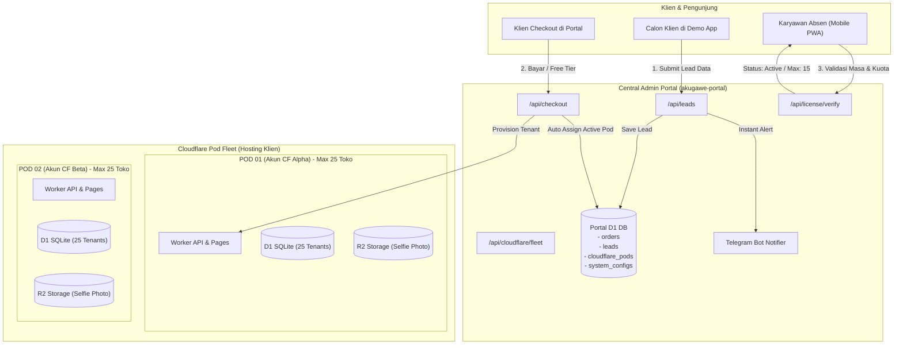
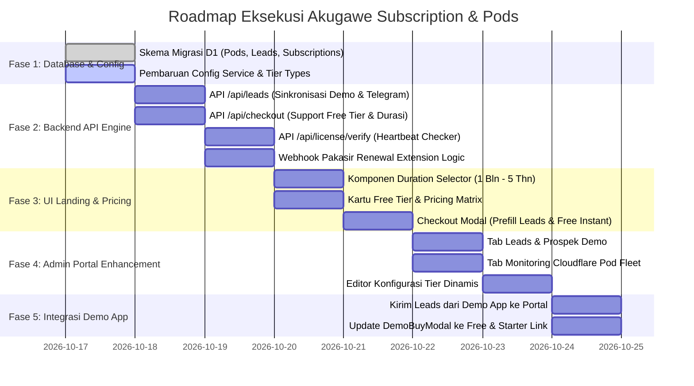

# BLUEPRINT & IMPLEMENTATION PLAN
## Akugawe Subscription Engine & Cloudflare Pod Fleet Architecture

Dokumen ini mendefinisikan objektif bisnis, arsitektur teknis, skema database, spesifikasi API, dan rencana implementasi bertahap untuk transformasi sistem **akugawe-portal** dari sistem lisensi beli putus (*one-time purchase*) menjadi **Multi-Tenant SaaS Recurring Subscription** dengan arsitektur **Cloudflare Pod Grouping**.

---

## 1. Executive Summary & Business Objectives

### 1.1 Objektif Bisnis
1. **Model Bisnis Berulang (*Monthly Recurring Revenue / MRR*):**
   * Mengganti sistem beli putus menjadi paket berlangganan dengan fleksibilitas durasi: **1 Bulan, 3 Bulan, 6 Bulan, 1 Tahun, 2 Tahun, dan 5 Tahun**.
2. **Penawaran Masuk Terjangkau (*Low Barrier to Entry*):**
   * **Free Tier:** Maksimal 4 karyawan, durasi aktif 4 bulan penuh, harga Rp 0 (Trial tanpa kartu kredit/pembayaran).
   * **Starter UMKM:** Maksimal 15 karyawan, mulai dari **Rp 15.000/bulan** (dengan diskon bertingkat untuk komitmen tahunan).
   * **Pro & Enterprise:** Skalabel untuk kebutuhan tim lebih besar atau multi-cabang.
3. **Efisiensi Finansial & Infrastruktur Rp 0:**
   * Memanfaatkan kuota gratis Cloudflare Free Plan (*100.000 requests/hari, 10 GB R2, 5 juta D1 reads/hari*) melalui **Arsitektur Grouping (Pod)**.
   * Setiap 1 Akun Cloudflare meng-host **20–25 Perusahaan**, sehingga 100 klien hanya membutuhkan 4 akun Cloudflare.
   * Gross profit margin vendor mencapai **>95%**.
4. **Otomasi Penuh & Zero-Touch Onboarding:**
   * Klien tidak perlu tahu atau mengurus akun Cloudflare.
   * Registrasi Free Tier maupun Paid Tier aktif secara **instan ($\le$ 3 detik)**.
5. **Sinkronisasi Leads Mode Demo:**
   * Setiap calon pelanggan yang mencoba demo di aplikasi `app` otomatis tersinkronisasi ke portal dan memicu alert real-time ke Telegram Admin.

---

## 2. Arsitektur Sistem: Cloudflare Pod Fleet (Grouping)

### 2.1 Konsep Pod / Cluster
Alih-alih membuat 1 akun Cloudflare untuk setiap 1 perusahaan, sistem menggunakan model **Pod Multi-Tenant**:
* **1 Pod = 1 Akun Cloudflare.**
* Di dalam 1 Pod, terdapat **1 Database D1 SQLite Bersama** dengan isolasi data berbasis `company_id`.
* Setiap Pod memiliki batas kuota aman: **Maksimal 25 Perusahaan** atau **$\pm$ 400 Karyawan Aktif**.
* Ketika sebuah Pod mendekati kapasitas penuh ($\ge$ 22 perusahaan), Portal memicu notifikasi peringatan ke Telegram Admin untuk menyiapkan Pod berikutnya.

### 2.2 Diagram Alur Arsitektur



---

## 3. Matriks Paket & Harga Dinamis

Seluruh parameter tier tersimpan dalam format JSON di database `system_configs` dengan kunci `PRICING_TIERS_CONFIG`, sehingga dapat diedit langsung melalui **Admin Portal** tanpa deploy ulang kode.

### 3.1 Struktur Default Paket

```json
[
  {
    "id": "free_trial",
    "name": "Free Trial UMKM",
    "badge": "Gratis 4 Bulan",
    "isFree": true,
    "freeDurationMonths": 4,
    "maxEmployees": 4,
    "description": "Uji coba penuh sistem absensi & payroll untuk usaha rintisan mikro.",
    "features": [
      "Maksimal 4 Karyawan Aktif",
      "Masa Aktif 4 Bulan Penuh (Rp 0)",
      "PWA Mobile Absensi GPS & Selfie",
      "Dashboard Owner & Slip Gaji Standar",
      "Subdomain Instan (app.akugawe.id/slug)",
      "Tanpa Kartu Kredit / Biaya Setup"
    ]
  },
  {
    "id": "starter",
    "name": "Starter UMKM",
    "badge": "Paling Hemat",
    "isFree": false,
    "maxEmployees": 15,
    "description": "Pilihan tepat untuk toko, kedai, kafe, atau bengkel dengan s/d 15 staf.",
    "pricing": {
      "1": { "normalRp": 15000, "promoRp": 15000, "discountPercent": 0, "label": "1 Bulan" },
      "3": { "normalRp": 45000, "promoRp": 42000, "discountPercent": 7, "label": "3 Bulan" },
      "6": { "normalRp": 90000, "promoRp": 78000, "discountPercent": 13, "label": "6 Bulan" },
      "12": { "normalRp": 180000, "promoRp": 138000, "discountPercent": 23, "badge": "Best Value", "label": "1 Tahun" },
      "24": { "normalRp": 360000, "promoRp": 240000, "discountPercent": 33, "label": "2 Tahun" },
      "60": { "normalRp": 90000, "promoRp": 480000, "discountPercent": 47, "badge": "Super Saver", "label": "5 Tahun" }
    },
    "features": [
      "Maksimal 15 Karyawan Aktif",
      "Pilihan Durasi 1 Bulan s/d 5 Tahun",
      "Geofencing Radius GPS Meter & Anti-Fake GPS",
      "Otomasi Payroll & Export Slip Gaji PDF",
      "Pencatatan Lembur, Kasbon, & Izin Cuti",
      "Prioritas Dukungan Teknis WhatsApp"
    ]
  },
  {
    "id": "business_pro",
    "name": "Business Pro",
    "badge": "Bisnis Berkembang",
    "isFree": false,
    "maxEmployees": 50,
    "description": "Untuk bisnis dengan banyak staf, multi-cabang, atau shift fleksibel.",
    "pricing": {
      "1": { "normalRp": 39000, "promoRp": 35000, "discountPercent": 10, "label": "1 Bulan" },
      "3": { "normalRp": 117000, "promoRp": 99000, "discountPercent": 15, "label": "3 Bulan" },
      "6": { "normalRp": 234000, "promoRp": 189000, "discountPercent": 19, "label": "6 Bulan" },
      "12": { "normalRp": 468000, "promoRp": 349000, "discountPercent": 25, "badge": "Best Value", "label": "1 Tahun" },
      "24": { "normalRp": 936000, "promoRp": 599000, "discountPercent": 36, "label": "2 Tahun" },
      "60": { "normalRp": 2340000, "promoRp": 1199000, "discountPercent": 49, "label": "5 Tahun" }
    },
    "features": [
      "Maksimal 50 Karyawan Aktif",
      "Multi-Cabang & Multi-Lokasi Kantor",
      "Pengaturan Shift Kerja Kompleks",
      "Laporan Analitik Kehadiran & Rekap PPh 21",
      "Bot Notifikasi Telegram Absensi Harian"
    ]
  }
]
```

---

## 4. Sistem Lisensi, Quota Enforcement & Heartbeat API

### 4.1 Logika Gatekeeper pada Aplikasi Klien
Aplikasi absensi klien (*app*) memanggil endpoint portal `/api/license/verify` secara berkala (dengan caching lokal di KV selama 6–12 jam):

1. **Pengecekan Waktu (Masa Aktif):**
   * $\text{Hari Ini} \le \text{current\_period\_end}$: Status `ACTIVE` $\rightarrow$ Aplikasi normal.
   * $0 < \text{Hari Telat} \le 3 \text{ Hari}$: Status `GRACE_PERIOD` $\rightarrow$ Banner kuning peringatan perpanjangan, absensi tetap berfungsi.
   * $\text{Hari Telat} > 3 \text{ Hari}$: Status `SUSPENDED` $\rightarrow$ Layar aplikasi terkunci total dengan tombol pembayaran QRIS perpanjangan.
2. **Pengecekan Kuota Karyawan:**
   * Di dashboard admin toko, saat pendaftaran karyawan baru:  
     $$\text{Total Karyawan Aktif} \ge \text{max\_employees}$$
   * Tombol "Simpan Karyawan" diblokir dengan pesan:  
     *"Batas {max_employees} karyawan untuk paket Anda telah tercapai. Tingkatkan paket langganan untuk menambah staf."*

---

## 5. Sinkronisasi Leads Demo (`app` $\leftrightarrow$ `portal`)

1. **Di Sisi Aplikasi Demo (`app/apps/api/src/routes/demo.ts`):**
   * Saat user mengirimkan form di `DemoLeadModal`:
     Data `email`, `name`, `phone`, `companyName`, `employeeCount`, `roleExplored` disimpan di database lokal demo.
   * Secara asinkron (*non-blocking*), aplikasi mem-forward payload ke:  
     `POST https://portal.domain.com/api/leads`
2. **Di Sisi Portal (`akugawe-portal`):**
   * Endpoint `/api/leads` menyimpan data prospek ke tabel `leads`.
   * Memicu pesan bot Telegram instan ke Admin:  
     ```
     🔥 NEW PROSPECT LEAD DARI DEMO APP!
     ━━━━━━━━━━━━━━━━━━━━━━
     👤 Nama      : Budi Santoso
     🏢 Perusahaan: Toko Kopi Senja
     📱 WhatsApp  : 0812-3456-7890
     ✉️ Email     : budi@kopisenja.com
     👥 Karyawan  : 10 Orang
     🎯 Role Demo : Owner
     ⏰ Waktu     : 16 Okt 2026, 22:30 WIB
     ━━━━━━━━━━━━━━━━━━━━━━
     👉 Follow up sekarang via WhatsApp!
     ```
3. **Konversi 1-Klik ke Free Tier / Berbayar:**
   * Pada `DemoBuyModal` di app, tombol diarahkan ke:  
     `https://portal.domain.com/?checkout=true&ref=demo&name=...&phone=...&email=...&company=...&tier=free_trial`
   * Modal checkout di portal langsung terisi otomatis (*prefilled*).

---

## 6. Skema Database Cloudflare D1 (Database Migrations)

File migrasi baru: `migrations/0002_subscription_pods_schema.sql`

```sql
-- 1. Tabel Cloudflare Pods (Cluster Multi-Tenant Hosting)
CREATE TABLE IF NOT EXISTS cloudflare_pods (
    id TEXT PRIMARY KEY,                       -- e.g. 'pod-01'
    name TEXT NOT NULL,                        -- e.g. 'Cluster Alpha'
    cf_account_id TEXT NOT NULL,               -- 32 hex chars Cloudflare Account ID
    cf_account_email TEXT NOT NULL,            -- Email akun CF (e.g. cf+pod1@akugawe.id)
    app_base_url TEXT NOT NULL,                -- e.g. 'https://app.akugawe.id'
    api_base_url TEXT NOT NULL,                -- e.g. 'https://api-pod1.akugawe.id'
    max_companies INTEGER DEFAULT 25,          -- Batas aman tenant per akun
    current_companies_count INTEGER DEFAULT 0, -- Jumlah perusahaan yang terisi
    is_active INTEGER DEFAULT 1,               -- 1 = Menerima tenant baru, 0 = Penuh/Maintenance
    notes TEXT,
    created_at DATETIME DEFAULT CURRENT_TIMESTAMP,
    updated_at DATETIME DEFAULT CURRENT_TIMESTAMP
);

-- 2. Modifikasi / Perluasan Tabel Orders & Subscriptions
-- Tambahkan kolom penunjang subscription pada tabel orders
ALTER TABLE orders ADD COLUMN billing_cycle_months INTEGER DEFAULT 1;
ALTER TABLE orders ADD COLUMN subscription_status TEXT DEFAULT 'active'; -- 'active', 'grace_period', 'suspended', 'cancelled'
ALTER TABLE orders ADD COLUMN current_period_start DATETIME;
ALTER TABLE orders ADD COLUMN current_period_end DATETIME;
ALTER TABLE orders ADD COLUMN max_employees INTEGER DEFAULT 15;
ALTER TABLE orders ADD COLUMN pod_id TEXT REFERENCES cloudflare_pods(id);
ALTER TABLE orders ADD COLUMN is_shared_pod INTEGER DEFAULT 1; -- 1: Grouping Pod, 0: Dedicated
ALTER TABLE orders ADD COLUMN last_payment_amount INTEGER DEFAULT 0;
ALTER TABLE orders ADD COLUMN last_payment_date DATETIME;
ALTER TABLE orders ADD COLUMN buyer_email TEXT;

-- 3. Tabel Riwayat Invoice & Perpanjangan Langganan
CREATE TABLE IF NOT EXISTS invoices (
    id TEXT PRIMARY KEY,                       -- e.g. 'INV-202610-001'
    order_id TEXT NOT NULL REFERENCES orders(id),
    client_slug TEXT NOT NULL,
    package_tier_id TEXT NOT NULL,
    cycle_months INTEGER NOT NULL,
    amount_rp INTEGER NOT NULL,
    payment_status TEXT DEFAULT 'pending',     -- 'pending', 'paid', 'expired'
    payment_method TEXT DEFAULT 'pakasir_qris',
    payment_ref TEXT,
    due_date DATETIME NOT NULL,
    paid_at DATETIME,
    created_at DATETIME DEFAULT CURRENT_TIMESTAMP
);

-- 4. Tabel Prospek & Leads Mode Demo
CREATE TABLE IF NOT EXISTS leads (
    id TEXT PRIMARY KEY,                       -- UUID
    email TEXT NOT NULL,
    name TEXT,
    phone TEXT,
    company_name TEXT,
    employee_count TEXT,
    role_explored TEXT DEFAULT 'owner',
    source TEXT DEFAULT 'app_demo',
    status TEXT DEFAULT 'new',                 -- 'new', 'contacted', 'converted', 'closed'
    notes TEXT,
    last_contacted_at DATETIME,
    converted_order_id TEXT,
    created_at DATETIME DEFAULT CURRENT_TIMESTAMP,
    updated_at DATETIME DEFAULT CURRENT_TIMESTAMP
);

-- Indexes untuk akselerasi query
CREATE INDEX IF NOT EXISTS idx_orders_subscription_status ON orders(subscription_status);
CREATE INDEX IF NOT EXISTS idx_orders_current_period_end ON orders(current_period_end);
CREATE INDEX IF NOT EXISTS idx_orders_pod_id ON orders(pod_id);
CREATE INDEX IF NOT EXISTS idx_leads_email ON leads(email);
CREATE INDEX IF NOT EXISTS idx_leads_status ON leads(status);
CREATE INDEX IF NOT EXISTS idx_invoices_order_id ON invoices(order_id);
```

---

## 7. Spesifikasi API Endpoint Portal

| Endpoint | Method | Autentikasi | Deskripsi & Respons |
|---|---|---|---|
| `/api/checkout` | `POST` | Public | Membuat langganan baru. Jika `isFree: true` $\rightarrow$ Langsung terbitkan lisensi aktif 4 bulan (Rp 0, tanpa QRIS). Jika berbayar $\rightarrow$ Generate tagihan Pakasir QRIS dinamis. |
| `/api/license/verify` | `GET` | Public / Token | Heartbeat checker untuk app klien. Memeriksa sisa hari aktif, status (`active`, `grace_period`, `suspended`), dan kuota `maxEmployees`. |
| `/api/leads` | `POST` | Public / API Key | Endpoint webhook penerima sinkronisasi data prospek dari demo app + trigger notifikasi Telegram bot. |
| `/api/leads` | `GET` | Admin Session | Mengambil daftar seluruh prospek demo untuk ditampilkan di Admin Portal. |
| `/api/webhooks/pakasir` | `POST` | Signature Pakasir | Menerima webhook pembayaran lunas $\rightarrow$ Menambah `current_period_end` $+N$ bulan $\rightarrow$ Update status ke `active`. |
| `/api/cloudflare/fleet` | `GET` | Admin Session | Mengambil data metrik Pod (kapasitas terpakai, status Cloudflare, kuota harian). |
| `/api/config` | `GET`, `POST` | Admin Session | Mengambil atau menyimpan konfigurasi tier dinamis (`PRICING_TIERS_CONFIG`). |

---

## 8. Rencana Implementasi Bertahap (Phased Roadmap)



---

## 9. Status & Tahap Selanjutnya

Blueprint ini menjadi acuan kerja resmi seluruh perubahan arsitektur.
